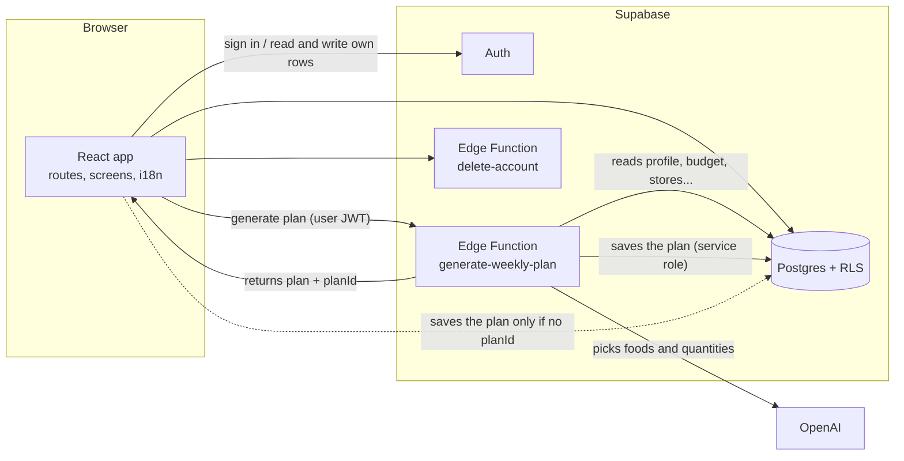

# Architecture

FitMarket AI is a single-page web app (React) backed by Supabase. The only
place that talks to OpenAI is a Supabase Edge Function, and that function does
**not** let the AI invent numbers: the AI only chooses foods and quantities
from a fixed catalog, and the server computes calories, prices and the
shopping list.

## Folder map

| Path | What lives there |
| --- | --- |
| `src/app/` | App shell, routes (`routes.ts`, `AppRoutes.tsx`), development-only screen gallery (`DevPreview.tsx`) |
| `src/app/components/` | Screens, grouped by feature: `auth`, `setup`, `generation`, `plan`, `account`, `shared` |
| `src/app/ui/` | Design system: buttons, fields, cards, screen layouts, states |
| `src/contexts/` | `AuthContext` (session) and `PlanContext` (current plan in memory) |
| `src/lib/` | Data access and pure helpers (profile, budget, goals, stores, plans, errors) |
| `src/i18n/` | Typed Spanish / English messages |
| `supabase/migrations/` | Database schema, in order |
| `supabase/functions/` | Edge Functions; `_shared/` holds code used by the functions **and** the browser |
| `data/price-samples/` | Hand-collected price samples used to calibrate the catalog |
| `scripts/eval-plans.mjs` | Offline quality check of generated plans (costs OpenAI credit) |

## Frontend

- **Routing:** `wouter`. Every URL is defined once in `routes.ts`. `Protected`
  in `AppRoutes.tsx` sends signed-out users to login. Screens are lazy-loaded.
- **State:** there is no global store. The session comes from `AuthContext`, the
  plan in memory from `PlanContext`, and everything else is read from Supabase
  when a screen opens.
- **Language:** `defineMessages({ es, en })` forces every text to exist in both
  languages (a missing key is a compile error). Library code returns message
  **keys** (`ErrorKey`), never text, so errors are shown in the user's
  language. The choice is saved in the browser and in the user's account.
- **Styling:** Tailwind CSS v4 with design tokens in `src/styles/theme.css`.
- **Dev gallery:** `/__preview/<screen>` renders a screen with sample data
  without an account. It only exists in development builds.

## Database

All tables have Row Level Security: a user only sees their own rows.

| Table | Purpose |
| --- | --- |
| `profiles` | One row per user: age, weight, height, activity level, sex (optional), household size, weekly budget, dietary restrictions |
| `supermarkets` | Master list of supermarkets |
| `cities` | Cities where prices can be shown (launch city: Bucaramanga); `profiles.city` points here |
| `foods` | The food catalog: nutrition, pack size, static reference price (migrations 011-012) |
| `store_products` | Which store sells which food, with its product page and pack size |
| `prices` | Weekly prices per store product and city, with `source` (`official`, `user`, `estimate`) and date |
| `current_prices` | View with the latest valid price per store product and city |
| `city_reference_prices` | DANE SIPSA wholesale prices per food and city (migration 013); base of the "Aproximado" estimates |
| `user_goals`, `user_supermarkets` | The goals and supermarkets each user chose |
| `weekly_plans` | Every generated plan, stored as JSON (`plan_json`) |
| `plan_generation_requests` | One row per generation try; used for the daily limit |

Users can delete their own rows but cannot edit the request counter. The
`delete-account` function removes the account and all its data.

## How a plan is generated

`supabase/functions/generate-weekly-plan` handles one request:

1. **Authenticate** the caller's JWT and **read** their profile, budget, goals,
   supermarkets and restrictions from the database.
2. **Daily limit:** insert a request row and count the last 24 hours (default
   10, configurable with `GENERATION_DAILY_LIMIT`). A failed try is given back
   only when nothing could have been charged at OpenAI (outage or missing
   config; any answer, empty answer or aborted call counts as billable); see
   `_shared/quota.ts`.
   **Per-plan caps** (`planner/callBudget.ts`): at most
   `GENERATION_MAX_MODEL_CALLS` model calls (default 12, ceiling 40) and
   `GENERATION_TIME_BUDGET_MS` from the request's arrival (default 120 s,
   ceiling 140 s, below the Edge Function limit). A new attempt needs 30 s
   left; a day-fill round runs only if every missing day fits in the budget
   (a partial round cannot complete the week); each call's timeout is cut to
   the time left.
3. **Budget floor:** below 40,000 COP per person per week no realistic plan
   exists, so it answers immediately without calling the AI.
4. **Restrictions:** free text such as "auyama" or "granos" is turned into
   catalog rules (`planner/restrictions.ts`, vocabulary in `foodNames.ts`).
   Forbidden foods are removed from the list the AI sees, so they are excluded
   by construction. Only foods sold by at least one of the user's supermarkets
   are offered.
5. **Targets:** calories and protein from the Mifflin-St Jeor formula, the
   activity level and the goals (`nutrition.ts`).
6. **Ask the AI** for 7 days of meals as catalog ids plus quantities, using a
   strict JSON schema in which `id` is an enum of the allowed foods.
7. **Repair:** if the answer has only some days, each missing day is requested
   on its own; an empty meal is filled from a neighbouring day.
8. **Quality gate:** at least 85% of the protein target and 14 different foods
   (slightly relaxed on the last try). If it fails, the AI gets feedback and
   tries again, up to 3 tries.
9. **Compute everything else on the server:** scale each day to the calorie
   target, price the shopping list in whole packs at the cheapest selected
   supermarket, and, if it is over budget, swap expensive foods for cheaper
   ones (`planner/swaps.ts`).
10. **Name the dishes:** meals changed by swaps are renamed so the dish name
    always matches its ingredients.
11. **Validate and save:** the plan is checked with the shared schema
    (`weeklyPlanSchema.ts`) and, only if it passes, saved in `weekly_plans`
    with the service role (`_shared/planStorage.ts`), waiting at most 5 s
    for the insert. `user_id` always comes from the verified JWT, never from
    the request body. A plan the schema rejects is not saved (it would hide
    the user's previous valid plan) and answers `invalid_format` (422), not
    refunded. When the save succeeds, a plan already paid for at OpenAI is
    kept even if the connection drops before the browser gets it.
12. **Return** `{ plan, planId }`, or an error code with diagnostics (how many
    foods were available, why each try failed). Tries that fail because of the
    service, not the user, are given back to the user's daily limit.

If the server save fails (no `SUPABASE_SERVICE_ROLE_KEY`, insert error or
timeout), the request does not fail: the answer is `{ plan }` without `planId`, the event
`plan_save_failed` is logged with a code only, and the browser saves the plan
itself with `saveWeeklyPlan`, as it always did. In that case the plan is only
kept if the browser receives it; a dropped connection still loses it.

The browser validates the plan again with the shared schema
(`weeklyPlanSchema.ts`) before showing it. `planId` is accepted only if it is
a UUID string (`src/lib/planId.ts`); with it the browser does not save again,
without it the browser saves and warns the user if that fails.

**Transition.** Saving from the browser (`saveWeeklyPlan` and the RLS
insert/update policies on `weekly_plans`) is kept on purpose so any deploy
order works: a new app against an old function gets no `planId` and saves as
before; an old app against a new function saves a second copy, so a plan
generated during that window may appear twice in the history. Removing the
browser save and those policies is a later, separate step.

### Why a catalog

Asking a language model for prices and calories produces plausible but wrong
numbers. With a catalog the AI only decides what to eat; cost and nutrition
are arithmetic. The catalog now lives in the database (`foods`), and
`_shared/catalog.ts` keeps the same foods as a static copy used as a fallback.

### Catalog loader, cache and fallback

`_shared/catalogLoader.ts` reads the catalog, the stores that sell each food
and the prices of the user's city from the database. The result is cached in
the function's memory (10 minutes by default, `CATALOG_CACHE_TTL_MS`, at most
1 hour), so thousands of users do not each trigger the same queries. If the
database cannot be read, the loader falls back to the static catalog and
static prices, so a plan can still be generated; the log event
`catalog_origin` says whether `db` or the static copy was used.

### Price book

`planner/priceBook.ts` answers "how much does this food cost at this store?"
for the planner. In order of trust:

1. A real price read from the store (`official`) or reported by users
   (`user`, plan 5), if it is not older than 45 days.
2. Otherwise an **estimate**: the DANE reference price of the city (if it is
   within 0.33x-3x of the static reference price) or the static reference
   price, times a per-store factor. DANE wholesale prices get a retail markup
   (fresh produce 1.35, protein 1.20, staples 1.15).
3. Users without a city keep the old behaviour (static prices).

Each plan item records its source and date. The app shows "Actualizado el ..."
for read prices and "Aproximado" for estimates (also for old plans that have
no source).

## Weekly prices

A GitHub Actions workflow (`prices-weekly.yml`, Mondays 09:00 UTC, or by hand
with `dry_run`) runs in the protected environment `prices` and writes with the
service role. It has two parts:

- **Store readers** (`scripts/prices/`): Exito, Carulla, Jumbo and D1 product
  pages (VTEX; D1 at www.d1.com.co). Ara is **not** read because its terms
  forbid it; Ara prices will come from user reports (plan 5) and DANE
  estimates. Only product pages that robots.txt allows, at least 5 s between
  requests, stop on a 429 or a block, and only the regular price and the pack
  size are stored. The rules are in `scripts/prices/policy.json` (see
  `docs/PRICE_SOURCES.md`). Prices out of a sane range are rejected and the
  last good price is kept.
- **DANE SIPSA** (`scripts/prices/dane/`): official wholesale prices for
  Bucaramanga, saved in `city_reference_prices`, with the DANE attribution.

The job never calls OpenAI and never changes plans already saved.

## Code shared between browser and functions

`supabase/functions/_shared` is imported by the app through the `@shared`
alias (see `vite.config.ts` and `tsconfig.json`). That keeps the plan schema,
error codes, nutrition formulas and food vocabulary in one place, so the app
and the server cannot disagree.

## Quality and security

- `npm run check` type-checks the app and the functions and runs the tests
  (`node --test`). The planner is tested with a fake model, so no OpenAI calls
  are needed.
- GitHub Actions runs install, check, build and `npm audit` on every push and
  pull request.
- The OpenAI key and the service-role key exist only as Supabase secrets.
  `VITE_*` variables are public by design.
- The function limits CORS to known origins, caps input length, and logs events
  without personal data.

## Known limits

- Real prices exist only for the foods already mapped to store pages; the
  rest use DANE-based or static estimates ("Aproximado"). Some static
  reference prices and per-store factors are still estimates.
- How each store selects Bucaramanga is not yet verified (all selectors are
  `verified: false`); Exito answered 429 in the live check.
- The Carulla potato mapping needs checking (slug says 180 g, mapped as 1 kg).
- Ara has no read prices until user reports exist (plan 5).
- Reading stores is authorized by the owner under precautions, but a legal
  review before public launch is pending.
- The catalog cache is per function instance and up to 10 minutes old.
- The AI chat screen is a placeholder.
- Dietary rules understand Spanish and English food names, but only for the
  foods in the catalog; a food that is not in it cannot be excluded or used.
