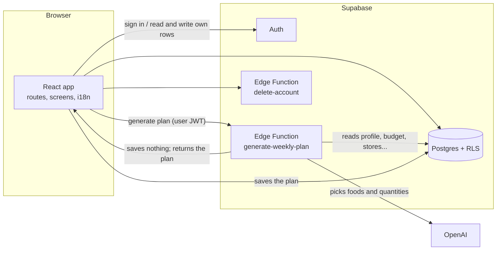

# Architecture

FitMarket AI is a single-page web app (React) backed by Supabase. The only
place that talks to OpenAI is a Supabase Edge Function, and that function does
**not** let the AI invent numbers: the AI only chooses foods and quantities
from a fixed catalog, and the server computes calories, prices and the
shopping list.

## Folder map

| Path | What lives there |
| --- | --- |
| `src/app/` | App shell, routes (`routes.ts`, `AppRoutes.tsx`), development-only screen gallery (`DevPreview.tsx`) |
| `src/app/components/` | Screens, grouped by feature: `auth`, `setup`, `generation`, `plan`, `account`, `shared` |
| `src/app/ui/` | Design system: buttons, fields, cards, screen layouts, states |
| `src/contexts/` | `AuthContext` (session) and `PlanContext` (current plan in memory) |
| `src/lib/` | Data access and pure helpers (profile, budget, goals, stores, plans, errors) |
| `src/i18n/` | Typed Spanish / English messages |
| `supabase/migrations/` | Database schema, in order |
| `supabase/functions/` | Edge Functions; `_shared/` holds code used by the functions **and** the browser |
| `data/price-samples/` | Hand-collected price samples used to calibrate the catalog |
| `scripts/eval-plans.mjs` | Offline quality check of generated plans (costs OpenAI credit) |

## Frontend

- **Routing:** `wouter`. Every URL is defined once in `routes.ts`. `Protected`
  in `AppRoutes.tsx` sends signed-out users to login. Screens are lazy-loaded.
- **State:** there is no global store. The session comes from `AuthContext`, the
  plan in memory from `PlanContext`, and everything else is read from Supabase
  when a screen opens.
- **Language:** `defineMessages({ es, en })` forces every text to exist in both
  languages (a missing key is a compile error). Library code returns message
  **keys** (`ErrorKey`), never text, so errors are shown in the user's
  language. The choice is saved in the browser and in the user's account.
- **Styling:** Tailwind CSS v4 with design tokens in `src/styles/theme.css`.
- **Dev gallery:** `/__preview/<screen>` renders a screen with sample data
  without an account. It only exists in development builds.

## Database

All tables have Row Level Security: a user only sees their own rows.

| Table | Purpose |
| --- | --- |
| `profiles` | One row per user: age, weight, height, activity level, sex (optional), household size, weekly budget, dietary restrictions |
| `supermarkets` | Master list of supermarkets |
| `user_goals`, `user_supermarkets` | The goals and supermarkets each user chose |
| `weekly_plans` | Every generated plan, stored as JSON (`plan_json`) |
| `plan_generation_requests` | One row per generation try; used for the daily limit |

Users can delete their own rows but cannot edit the request counter. The
`delete-account` function removes the account and all its data.

## How a plan is generated

`supabase/functions/generate-weekly-plan` handles one request:

1. **Authenticate** the caller's JWT and **read** their profile, budget, goals,
   supermarkets and restrictions from the database.
2. **Daily limit:** insert a request row and count the last 24 hours (default
   10, configurable with `GENERATION_DAILY_LIMIT`).
3. **Budget floor:** below 40,000 COP per person per week no realistic plan
   exists, so it answers immediately without calling the AI.
4. **Restrictions:** free text such as "auyama" or "granos" is turned into
   catalog rules (`planner/restrictions.ts`, vocabulary in `foodNames.ts`).
   Forbidden foods are removed from the list the AI sees, so they are excluded
   by construction. Only foods sold by at least one of the user's supermarkets
   are offered.
5. **Targets:** calories and protein from the Mifflin-St Jeor formula, the
   activity level and the goals (`nutrition.ts`).
6. **Ask the AI** for 7 days of meals as catalog ids plus quantities, using a
   strict JSON schema in which `id` is an enum of the allowed foods.
7. **Repair:** if the answer has only some days, each missing day is requested
   on its own; an empty meal is filled from a neighbouring day.
8. **Quality gate:** at least 85% of the protein target and 14 different foods
   (slightly relaxed on the last try). If it fails, the AI gets feedback and
   tries again, up to 3 tries.
9. **Compute everything else on the server:** scale each day to the calorie
   target, price the shopping list in whole packs at the cheapest selected
   supermarket, and, if it is over budget, swap expensive foods for cheaper
   ones (`planner/swaps.ts`).
10. **Name the dishes:** meals changed by swaps are renamed so the dish name
    always matches its ingredients.
11. **Return** the plan, or an error code with diagnostics (how many foods were
    available, why each try failed). Tries that fail because of the service,
    not the user, are given back to the user's daily limit.

The browser validates the plan again with the shared schema
(`weeklyPlanSchema.ts`) before showing or saving it.

### Why a catalog

Asking a language model for prices and calories produces plausible but wrong
numbers. With the catalog (`_shared/catalog.ts`, about 70 foods with
nutrition, pack size and a reference price) the AI only decides what to eat;
cost and nutrition are arithmetic. Prices marked `estimate` are not yet
verified against real shelves.

## Code shared between browser and functions

`supabase/functions/_shared` is imported by the app through the `@shared`
alias (see `vite.config.ts` and `tsconfig.json`). That keeps the plan schema,
error codes, nutrition formulas and food vocabulary in one place, so the app
and the server cannot disagree.

## Quality and security

- `npm run check` type-checks the app and the functions and runs the tests
  (`node --test`). The planner is tested with a fake model, so no OpenAI calls
  are needed.
- GitHub Actions runs install, check, build and `npm audit` on every push and
  pull request.
- The OpenAI key and the service-role key exist only as Supabase secrets.
  `VITE_*` variables are public by design.
- The function limits CORS to known origins, caps input length, and logs events
  without personal data.

## Known limits

- Many catalog prices and per-supermarket price factors are estimates.
- The AI chat screen is a placeholder.
- Dietary rules understand Spanish and English food names, but only for the
  foods in the catalog; a food that is not in it cannot be excluded or used.
