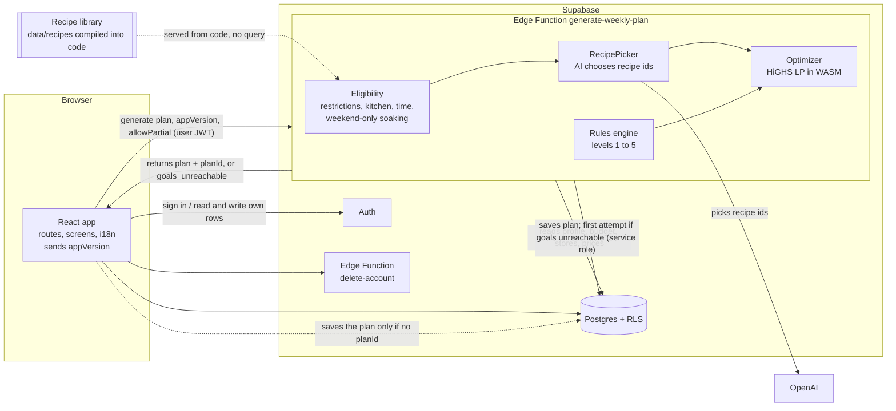

# Architecture

FitMarket AI is a single-page web app (React) backed by Supabase. The only
place that talks to OpenAI is a Supabase Edge Function, and that function does
**not** let the AI invent numbers or dishes: the AI only picks **recipe ids**
from a fixed library that lives in the repo, and the server computes portions,
calories, prices and the shopping list with a small linear-programming
optimizer (HiGHS).

## Folder map

| Path | What lives there |
| --- | --- |
| `src/app/` | App shell, routes (`routes.ts`, `AppRoutes.tsx`), development-only screen gallery (`DevPreview.tsx`) |
| `src/app/components/` | Screens, grouped by feature: `auth`, `setup`, `generation`, `plan`, `account`, `shared` |
| `src/app/ui/` | Design system: buttons, fields, cards, screen layouts, states |
| `src/contexts/` | `AuthContext` (session) and `PlanContext` (current plan in memory) |
| `src/lib/` | Data access and pure helpers (profile, budget, goals, stores, plans, errors) |
| `src/i18n/` | Typed Spanish / English messages |
| `supabase/migrations/` | Database schema, in order (015 cooking preferences, 016 `partial_plan_results`) |
| `supabase/functions/` | Edge Functions; `_shared/` holds code used by the functions **and** the browser |
| `supabase/functions/_shared/recipes/` | Recipe types, eligibility, meal expansion, soaking, and `library.generated.ts` (generated, never edited by hand) |
| `supabase/functions/_shared/planner/` | The generation pipeline: `generate.ts`, `recipePicker.ts`, `callBudget.ts`, `priceBook.ts`, `lp.ts` (HiGHS adapter) |
| `supabase/functions/_shared/planner/rules/` | Goal targets and the level 1-5 rule set and evaluation |
| `supabase/functions/_shared/planner/optimizer/` | LP model builder and solve (`model.ts`, `optimize.ts`) |
| `supabase/functions/_shared/generationRequest.ts`, `generationResponse.ts` | Request body parsing (`appVersion`, `allowPartial`) and error answers shaped for the client's version |
| `supabase/functions/_shared/partialPlanStore.ts` | Stores and reuses the first attempt for "Quiero el plan igual" |
| `supabase/functions/generate-weekly-plan/` | The function, its `deno.json` and (copied before deploy, not in git) `highs.wasm` |
| `data/recipes/` | The recipe library, one JSON file per recipe (see `docs/RECIPES.md`) |
| `data/foods/` | Food data source (`foods.json`) behind the catalog and its micro-nutrients |
| `data/price-samples/` | Hand-collected price samples used to calibrate the catalog |
| `scripts/recipes/` | Recipe schema, library builder and coverage tests |
| `scripts/eval-plans.mjs` | Offline quality check of generated plans (costs OpenAI credit) |

## Frontend

- **Routing:** `wouter`. Every URL is defined once in `routes.ts`. `Protected`
  in `AppRoutes.tsx` sends signed-out users to login. Screens are lazy-loaded.
- **State:** there is no global store. The session comes from `AuthContext`, the
  plan in memory from `PlanContext`, and everything else is read from Supabase
  when a screen opens.
- **Language:** `defineMessages({ es, en })` forces every text to exist in both
  languages (a missing key is a compile error). Library code returns message
  **keys** (`ErrorKey`), never text, so errors are shown in the user's
  language. The choice is saved in the browser and in the user's account.
- **Styling:** Tailwind CSS v4 with design tokens in `src/styles/theme.css`.
- **Dev gallery:** `/__preview/<screen>` renders a screen with sample data
  without an account. It only exists in development builds.

## Database

All tables have Row Level Security: a user only sees their own rows.

| Table | Purpose |
| --- | --- |
| `profiles` | One row per user: age, weight, height, activity level, sex (optional), household size, weekly budget, dietary restrictions, optional cooking answers: weekday minutes, level, appliances, batch cooking (migration 015) |
| `supermarkets` | Master list of supermarkets |
| `cities` | Cities where prices can be shown (launch city: Bucaramanga); `profiles.city` points here |
| `foods` | The food catalog: nutrition, pack size, static reference price (migrations 011-012) |
| `store_products` | Which store sells which food, with its product page and pack size |
| `prices` | Weekly prices per store product and city, with `source` (`official`, `user`, `estimate`) and date |
| `current_prices` | View with the latest valid price per store product and city |
| `city_reference_prices` | DANE SIPSA wholesale prices per food and city (migration 013); base of the "Aproximado" estimates |
| `user_goals`, `user_supermarkets` | The goals and supermarkets each user chose |
| `weekly_plans` | Every generated plan, stored as JSON (`plan_json`) |
| `plan_generation_requests` | One row per generation try; used for the daily limit |
| `partial_plan_results` | The first attempt of a plan that missed some goals, kept 30 minutes for "Quiero el plan igual" (migration 016): one row per user, only the service role writes, the user can read and delete their own |

Users can delete their own rows but cannot edit the request counter. The
`delete-account` function removes the account and all its data.

## How a plan is generated

`supabase/functions/generate-weekly-plan` handles one request. The pure,
tested logic lives in `_shared/planner/generate.ts` (`generatePlan`); `index.ts`
only does HTTP, authentication, the daily limit and saving.

1. **Authenticate** the caller's JWT and **read** their profile (including the
   optional cooking answers), budget, goals, supermarkets and restrictions.
   The cooking columns are read in a separate query: if migration 015 is
   missing, defaults are used (20 weekday minutes, basic level, stove and
   blender, no batch cooking).
2. **Read the request body** (`generationRequest.ts`): at most 2048 characters,
   any invalid field is ignored. `appVersion` must look like `1.2.3`;
   `allowPartial` counts only when it is the boolean `true`. An empty body
   (`{}`, the old web) means "no version, no partial".
3. **"Quiero el plan igual" reuse** (only when `allowPartial` is true): the
   function first tries to take the stored first attempt from
   `partial_plan_results` (see below). If it is found, the plan is assembled
   from it and everything after this step, **including the daily quota row and
   OpenAI**, is skipped.
4. **Daily limit:** insert a request row and count the last 24 hours (default
   10, `GENERATION_DAILY_LIMIT`). A failed try is given back only when nothing
   could have been charged at OpenAI (`_shared/quota.ts`): outage, missing
   config, rate limit, or the solver failing to load (`refundable`).
   `goals_unreachable` is never refunded. **Per-plan caps**
   (`planner/callBudget.ts`): at most `GENERATION_MAX_MODEL_CALLS` model calls
   (default 12, ceiling 40) and `GENERATION_TIME_BUDGET_MS` from the request's
   arrival (default 120 s, ceiling 140 s).
5. **Budget floor:** below `MIN_WEEKLY_BUDGET_PER_PERSON_COP` = 130,000 COP per
   person per week (times the household size) no realistic plan exists, so it
   answers `budget_too_low` immediately without calling the AI.
6. **Targets and rules:** `planner/rules/targets.ts` computes calories and
   protein (Mifflin-St Jeor, activity, goals, household factor, blocked goals
   for minors, older adults, low BMI and health conditions);
   `rules/ruleSet.ts` turns them into a `RuleSet` of levels 1 to 5 (below).
7. **Eligibility** (`recipes/eligibility.ts`): from the library, keep the
   recipes that respect the restrictions, fit the user's kitchen appliances,
   cooking level and weekday minutes (weekend recipes may take up to 60
   minutes and one level more), and use foods sold by the user's supermarkets.
   A recipe that cooks a **soak legume** (`frijol`, `garbanzo`, `arveja_seca`)
   is weekend-only, and the plan carries one reminder the evening before. If
   any slot has fewer than 3 recipes (`MIN_RECIPES_PER_SLOT`) the answer is
   `restrictions_too_strict` with the counts per slot.
8. **The AI picks recipes** (`planner/recipePicker.ts`, behind the pluggable
   `RecipePicker` interface; `createAiRecipePicker` is the OpenAI version).
   It receives a compact list of eligible recipes and returns one recipe id per
   day and meal as strict JSON. The prompt asks it to prefer shared
   ingredients and repeated dishes (cheaper shopping) and at most one
   high-fat dish per day. A missing day is requested on its own; an unknown id
   triggers a retry with feedback. A weekend-only dish on a weekday is moved by
   `repairWeekendOnly`, not rejected.
9. **Optimize** (`planner/optimizer/`): see "Optimizer" below.
10. **Outcome.** Up to 3 attempts. If the optimizer reports `relaxed` (some
    level 2-4 rule cannot be met) and there is time, the AI gets feedback built
    from the shortfalls ("more protein-rich recipes", "at least 2 legume
    dishes", ...) and picks again. After the last attempt:
    - everything met → the plan;
    - level 1 or the budget cannot be met → `budget_too_low` with the budget
      that would work, or `generation_failed` if the optimizer could not run;
    - rules left unmet and `allowPartial` is false → `goals_unreachable`;
    - rules left unmet and `allowPartial` is true → the plan, marked
      `compliance: partial`, with the unmet rules listed (the budget and level 1
      are still respected).
11. **Validate and save:** the plan is checked with the shared schema
    (`weeklyPlanSchema.ts`) and, only if it passes, saved in `weekly_plans`
    with the service role (`_shared/planStorage.ts`), waiting at most 5 s for
    the insert. `user_id` always comes from the verified JWT, never from the
    request body. A plan the schema rejects is not saved and answers
    `invalid_format` (422), not refunded.
12. **Return** `{ plan, planId }`, or an error answer shaped by
    `failureResponse` (`generationResponse.ts`) for the client's version (see
    "Compatibility").

If the server save fails (no `SUPABASE_SERVICE_ROLE_KEY`, insert error or
timeout), the request does not fail: the answer is `{ plan }` without `planId`,
the event `plan_save_failed` is logged with a code only, and the browser saves
the plan itself with `saveWeeklyPlan`. The browser validates the plan again
with the shared schema before showing it, and accepts `planId` only if it is a
UUID string (`src/lib/planId.ts`).

**Transition.** Saving from the browser (`saveWeeklyPlan` and the RLS
insert/update policies on `weekly_plans`) is kept on purpose so any deploy
order works: a new app against an old function gets no `planId` and saves as
before; an old app against a new function saves a second copy, so a plan
generated during that window may appear twice in the history. Removing the
browser save and those policies is a later, separate step.

### Rules (levels 1 to 5)

`planner/rules/ruleSet.ts` builds the rules; `rules/evaluate.ts` measures a
finished week against them.

| Level | Meaning | Examples |
| --- | --- | --- |
| 1 | Safety. **Never relaxed**, not even by "Quiero el plan igual" | calorie floor and ceiling, protein <= 2.5 g/kg (<= 1.2 with kidney disease), muscle protein floor, the household budget |
| 2 | The goal itself | calorie band of the goal, protein range per goal, muscle carbs and protein per meal |
| 3 | Healthy habits | fruit and vegetables, fiber, free sugar, sodium, fat, legumes per week, variety, food groups per day |
| 4 | Family | same recipes for every member, portions scaled per member |
| 5 | Saving | at least half the protein from cheap sources; always elastic, never reported as a conflict |

When two levels clash, the lower number wins: the optimizer pays a penalty for
breaking a level 2-5 rule (`PENALTY` in `optimizer/model.ts`, bigger for lower
levels) and treats level 1 and the budget as hard constraints. The exact
values are in the Plan 2 document, section "Rule values".

### Optimizer ("el contador")

`planner/optimizer/model.ts` builds a **linear program** (no integer
branching, so it stays fast): one portion-scale variable per recipe group and
role (protein, carb, veg, fat, condiment), one pack variable per food (whole
packs at the cheapest selected supermarket, `PriceBook.packOffer`), and the
rules as constraints. The objective is the lowest shopping cost plus penalties
for relaxed rules. `optimizer/optimize.ts` solves it with HiGHS
(`planner/lp.ts`, the `highs` package compiled to WebAssembly):

- Scales are bounded: a recipe's own range or `DEFAULT_ROLE_SCALE`.
  Protein-dense recipes may reach 2.5x and never more than 6 eggs per meal
  (`recipes/eligibility.ts`); salt is a fixed 1 g line; cooking oil is a
  `condiment` that may shrink to 0.5x and never grows.
- The result is rounded to real quantities and re-priced in whole packs. If
  rounding pushes the cost over the budget or breaks a level 1 rule, that
  constraint is tightened and the model solved again (at most 2 times). A week
  over the budget or breaking level 1 is never returned.
- If the first solve is infeasible or leaves slack, it also solves with the
  cheapest alternative of each line and keeps the better week. For diagnosis it
  solves a safety-only and a strict version to compute `requiredBudgetCop`.
- **CPU budget:** `OPTIMIZER_CPU_BUDGET_MS` = 900 ms (Edge Functions cap CPU
  time at 2 s). Every solve is charged to it; when it is spent no new solve
  starts and the run ends with `optimizer_cpu_exhausted`.
- The solver loads once per instance (`prepareLp`, 5 s timeout). The pipeline
  prepares it **before** the first paid AI call. If loading fails,
  `lpLoadError()` says why (`wasm_not_found`, `wasm_instantiate_failed` or
  `load_timeout`), the answer is `generation_failed` and the daily try is
  given back.
- Log events carry codes and counts only: `optimizer_result` (`status`,
  `solves`, `cpu_ms`), `optimizer_cpu_exhausted`, `lp_load_failed`.

### When goals cannot be met: `goals_unreachable`

If the best week still misses level 2-4 rules, the function does **not**
deliver a plan that quietly breaks them. It answers `goals_unreachable` with
`conflicts` (each unmet rule and what to change, for example protein
-0.15 g/kg), `canForce: true` and, when more money would fix it, a budget
option. The app shows this as "no se puede cumplir" and offers to change the
goals, raise the budget, or **"Quiero el plan igual"**.

"Quiero el plan igual" is the same request with `allowPartial: true`. The
first attempt is reused instead of recomputed:

- on `goals_unreachable` the function stores the optimized first attempt in
  `partial_plan_results` (migration 016): one row per user, written only with
  the service role, own-row `select` and `delete` through RLS, valid for 30
  minutes (`PARTIAL_PLAN_TTL_MS`, `partialPlanStore.ts`);
- the row carries a SHA-256 **fingerprint** of every input (budget, goals,
  stores, restrictions, household, profile, cooking, city, recipe library
  version and the Bogotá price day). If anything changed it does not match and
  the plan is generated again as usual;
- the retry takes the row (`delete ... returning`, single use) before the
  daily quota insert: **no extra daily try and no second AI call**. The week is
  validated again before use;
- if the table is missing (016 not applied) or a read fails, the function just
  never reuses and generates normally.

### Compatibility with older apps

The app sends `appVersion` (from `package.json`, now `0.1.0`). Only versions at
or above `MIN_VERSION_GOALS_UNREACHABLE = "0.1.0"` can receive
`goals_unreachable`. An old web, or one that sends `{}`, gets instead
`budget_too_low` (200, with the numbers) when a bigger budget fixes it, or
`goal_incoherent` (422) otherwise. `GenerationErrorCode` (`errors.ts`) does not
include `goals_unreachable` on purpose; `PipelineErrorCode` does. Every new
field in a plan is optional, so old plans and old apps render as before.

### Recipes

`data/recipes/*.json` (49 recipes, all `approved` by the owner on 2026-11-12)
are validated with zod and compiled by `scripts/recipes/build-library.ts` into
`_shared/recipes/library.generated.ts`, so recipes are served from code (no
query, no cache). A sync test fails if the generated file drifts; never edit it
by hand. Format and house rules: `docs/RECIPES.md`.

### Why recipes and a catalog

Asking a language model for prices, calories or dishes produces plausible but
wrong results. Here the AI only decides **which recipe goes where**; portions,
calories, rule checks and prices are arithmetic. The food catalog lives in the
database (`foods`), and `_shared/catalog.ts` keeps the same foods as a static
copy used as a fallback.

### Catalog loader, cache and fallback

`_shared/catalogLoader.ts` reads the catalog, the stores that sell each food
and the prices of the user's city from the database. The result is cached in
the function's memory (10 minutes by default, `CATALOG_CACHE_TTL_MS`, at most
1 hour), so thousands of users do not each trigger the same queries. If the
database cannot be read, the loader falls back to the static catalog and
static prices, so a plan can still be generated; the log event
`catalog_origin` says whether `db` or the static copy was used.

### Price book

`planner/priceBook.ts` answers "how much does this food cost at this store?"
for the planner. In order of trust:

1. A real price read from the store (`official`) or reported by users
   (`user`, plan 5), if it is not older than 45 days.
2. Otherwise an **estimate**: the DANE reference price of the city (if it is
   within 0.33x-3x of the static reference price) or the static reference
   price, times a per-store factor. DANE wholesale prices get a retail markup
   (fresh produce 1.35, protein 1.20, staples 1.15).
3. Users without a city keep the old behaviour (static prices).

Each plan item records its source and date. The app shows "Actualizado el ..."
for read prices and "Aproximado" for estimates (also for old plans that have
no source).

## Weekly prices

A GitHub Actions workflow (`prices-weekly.yml`, Mondays 09:00 UTC, or by hand
with `dry_run`) runs in the protected environment `prices` and writes with the
service role. It has two parts:

- **Store readers** (`scripts/prices/`): Exito, Carulla, Jumbo and D1 product
  pages (VTEX; D1 at www.d1.com.co). Ara is **not** read because its terms
  forbid it; Ara prices will come from user reports (plan 5) and DANE
  estimates. Only product pages that robots.txt allows, at least 5 s between
  requests, stop on a 429 or a block, and only the regular price and the pack
  size are stored. The rules are in `scripts/prices/policy.json` (see
  `docs/PRICE_SOURCES.md`). Prices out of a sane range are rejected and the
  last good price is kept.
- **DANE SIPSA** (`scripts/prices/dane/`): official wholesale prices for
  Bucaramanga, saved in `city_reference_prices`, with the DANE attribution.

The job never calls OpenAI and never changes plans already saved.

## Code shared between browser and functions

`supabase/functions/_shared` is imported by the app through the `@shared`
alias (see `vite.config.ts` and `tsconfig.json`). That keeps the plan schema,
error codes, nutrition formulas and food vocabulary in one place, so the app
and the server cannot disagree.

## Quality and security

- `npm run check` type-checks the app and the functions and runs the tests
  (`node --test`). The planner is tested with a fake model, so no OpenAI calls
  are needed.
- GitHub Actions runs install, check, build and `npm audit` on every push and
  pull request.
- The OpenAI key and the service-role key exist only as Supabase secrets.
  `VITE_*` variables are public by design.
- The function limits CORS to known origins, caps input length, and logs events
  without personal data.

## Known limits

- Real prices exist only for the foods already mapped to store pages; the
  rest use DANE-based or static estimates ("Aproximado"). Some static
  reference prices and per-store factors are still estimates.
- Plan costs and the 130,000 COP floor were measured with the **static price
  book**, not real Bucaramanga prices; they may shift once real prices flow in.
- The "healthy" goal still misses the fat rule in some weeks (the owner's
  measurements; `optimizer/healthyReach.test.mjs` samples how often it is
  reachable). Not re-verified for this document.
- Heavy muscle users (about 110 kg and above) can be infeasible because the
  protein floor needs more egg-free high-protein recipes (owner's finding; not
  re-verified for this document).
- Five known recipe coverage gaps return `restrictions_too_strict`
  (vegan + no cooking, gluten-free + no cooking, and lactose + gluten + fish-free
  with microwave only, microwave + 10 minutes, or no cooking); see
  `docs/RECIPES.md`.
- **Not verified until staging:** the Deno runtime of HiGHS and its static WASM
  file (loading, and CPU under 900 ms). Everything was measured in Node.
  See `docs/ROLLOUT-plan-2.md`.
- The Supabase free plan pauses a project after a period of inactivity.
- How each store selects Bucaramanga is not yet verified (all selectors are
  `verified: false`); Exito answered 429 in the live check.
- The Carulla potato mapping needs checking (slug says 180 g, mapped as 1 kg).
- Ara has no read prices until user reports exist (plan 5).
- Reading stores is authorized by the owner under precautions, but a legal
  review before public launch is pending.
- The catalog cache is per function instance and up to 10 minutes old.
- The AI chat screen is a placeholder.
- Dietary rules understand Spanish and English food names, but only for the
  foods in the catalog; a food that is not in it cannot be excluded or used.
